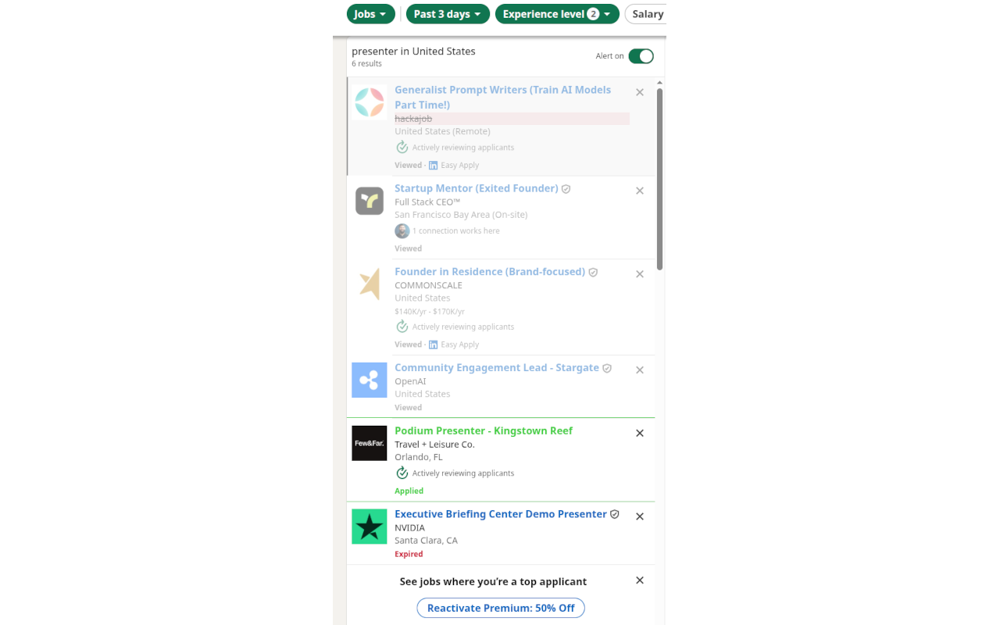
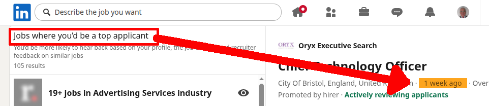

# LinkedIn Job Ad Marker




---

LinkedIn Job Ad Marker is an extension for Chrome and Firefox that marks LinkedIn job cards and blacklisted company profiles. It helps you work through large job lists faster by marking adverts you have already seen, jobs you have applied for, companies you do not want to deal with, and older listings you may want to skip.

The aim is simple: reduce repeat scanning. Instead of re-reading the same cards every time LinkedIn reshuffles, reloads, or promotes old listings again, the extension adds lightweight visual cues directly to the job list.

- **Chrome**: https://chromewebstore.google.com/detail/linkedin-job-ad-marker/eaegndbkfnnkmcedmhpdiiombakchjbe
- **FireFox**: Will be here: https://addons.mozilla.org/en-US/firefox/addon/linkedin-job-ad-marker/

## What It Does

On supported LinkedIn job pages, the extension scans job cards, extracts job identity where available, and compares that against locally stored data.

It then applies visual marks:

- `Viewed`: the card is faded with reduced opacity
- `Applied`: the card gets a green outline
- `Blacklisted company`: the company line gets a reddish background and strikethrough
- `Ageing`: LinkedIn publish-age tokens can be highlighted in orange when they are older than your configured threshold
- `Unwanted title`: cards whose title contains a configured word or phrase are struck through with a red double underline
- `Notes`: a small, non-clickable glyph indicates notes for the card's title and company

Blacklisted companies and unwanted titles are independent of job state, so a card can be both `Applied` and struck through, or `Viewed` and `Blacklisted`.

On supported LinkedIn jobs layouts, the ageing rule can mark:

- the publish date in the left-hand card list when LinkedIn exposes `time[datetime]`
- the relative age token in the left-hand AI-generated search cards, such as `4 days ago`
- the relative age token in the right-hand details panel, such as `2 weeks ago`

## How Viewed Jobs Are Tracked

The extension currently records a job as `viewed` when LinkedIn navigates to a specific job in the job details pane and the URL contains a `currentJobId`.

It also respects LinkedIn’s own `Viewed` badge on cards. If a card already shows LinkedIn’s `Viewed` state and the extension has no local record yet, it stores that as `viewed` as well.

## Context Menu Actions

Right-clicking on a LinkedIn jobs page gives you these actions:

- `Toggle company blacklist`
- `Toggle marker`
- `Mark as applied`
- `Add title to ignore list`
- `Add selection to ignore list` (when text is selected)
- `Add note`
- `Show notes`
- `Options`

`Toggle marker` is a session-level kill switch. It removes all visual marks until you enable the marker again.

`Options` opens the extension options page in a new tab.

## Notes

Right-click a card to add or show notes. Each note is an independent entry; adding another note never overwrites an existing one. Notes with the same title and company appear together, newest first, with their original LinkedIn job ID and creation time. A repost can therefore show earlier notes without pretending to be the same vacancy.

Notes can be created when the job ID is unavailable. They show “Job ID unavailable” instead of an invented ID. Editing preserves the original job ID and creation time; deleting affects only the selected entry. Unsaved changes require confirmation before being discarded.

Company matching normalises case and whitespace only. When a company-page slug is available, known different slugs remain separate. Name-only cards retain the ambiguity of companies with identical display names. Notes are plain text, remain on this device and have no automatic expiry.

## Options Page

The options page lets you configure a small set of extension settings stored in `chrome.storage.sync`:

- debug logging on/off
- ageing limit in days
- treat Promoted and Reposted as Viewed
- unwanted title words (comma-separated)
- viewed opacity
- applied colour
- blacklisted colour

It also provides:

- `Save`
- `Cancel`
- `Export`
- `Import`
- `Close`

Colour and ageing changes are applied live to LinkedIn pages, so a page reload is not required.

`Ageing limit (days)` accepts values from `1` to `7`. Any other value is treated as disabled and shown as `(disabled)` in the options page while remaining editable.

## Export and Import

Export creates a complete JSON backup without requiring a LinkedIn tab. It includes saved settings, jobs, companies and every independent note, including soft-deleted records.

The format is `ljm-export`, schema version `2`, with export time and extension version recorded separately. Older export files remain importable. The whole file is validated before writing; invalid files report an error.

Version 2 imports merge matching record IDs by `updatedAt`: the newer record wins, including deletions. Repeated imports do not duplicate note IDs. Ordinary job tracking still promotes viewed jobs to applied without downgrading them; importing a newer record is an explicit restore operation.

## Storage

The extension uses two browser storage layers:

### IndexedDB

The extension background owns the `ljm-data` database, with stores for jobs, companies, notes and schema metadata. Clearing LinkedIn site data does not clear this extension database.

Records have client-generated IDs, creation/update timestamps and optional deletion timestamps. The LinkedIn job ID is a separate indexed field. Deleted records are hidden in normal use and preserved in backups.

Existing LinkedIn-origin job history is migrated when a LinkedIn page is opened. Only acknowledged, committed records that have not subsequently changed are removed from the legacy store. An older tab can continue writing without those new records being discarded. The empty legacy database may remain during the transition.

### `chrome.storage.sync`

Used for:

- options
- a per-company blacklist mirror, including deletion records

Settings and blacklist data can follow the signed-in browser profile when browser sync is enabled. Jobs and notes are not synced. During the migration transition, the old blacklist array is retained for older extension versions. The options page warns if sync cannot continue; local data remains available.

## Where It Runs

The extension injects on:

- `https://www.linkedin.com/*`

It activates job-marking logic on supported LinkedIn Jobs surfaces and company-name marking on company profiles.

This broader match is intentional, because LinkedIn often moves into job pages through SPA navigation rather than a full page load.

## Troubleshooting

### Firefox: extension is enabled but LinkedIn is not marked

Check the extension's site permission, even if its background page starts without errors:

1. Open `about:addons` and select **LinkedIn Job Ad Marker**.
2. Open **Permissions and data**.
3. Enable **Access your data for https://www.linkedin.com**.
4. Reload the LinkedIn tab.

Without this permission, Firefox cannot inject the extension's content scripts. LinkedIn's own console errors do not necessarily indicate an extension problem.

For development, you can check the permission from the extension's console: open `about:debugging#/runtime/this-firefox`, click **Inspect** beside the extension, then run:

```js
browser.permissions.contains({
  origins: ["https://www.linkedin.com/*"]
}).then(console.log)
```

The result should be `true`. Run this in the extension's background context (`moz-extension://…/_generated_background_page.html`), not the LinkedIn page console or Firefox's `webextension-fallback.html` debugging page.

### Firefox: loading a local development copy

Use the Firefox manifest from `FF/manifest.json` as the development package's root `manifest.json`, alongside the `src/` and `icons/` directories. Its paths are relative to that root; placing it inside `src/` makes them point to missing files such as `src/src/content.js`. Keep a separate package or preserve the Chrome manifest when preparing a Firefox copy.

If you move the development package, use **Load Temporary Add-on** in `about:debugging` to select the manifest at its new location, then reload LinkedIn.

## Privacy

Jobs and notes are stored locally in the extension. Settings and blacklisted companies use the browser's sync service when enabled. The extension does not send data to an application server or require a separate account.


> [!NOTE]
> Job lists opened from email links (such as job alert emails) are snapshots generated at send time. The relative age text shown on each card (e.g. `1 day ago`) reflects the time of generation, **not the time of viewing**. If you open such a link a day or more after the email was sent, the displayed age will be behind the actual calendar date. For example, a card showing `1 day ago` may have a `datetime` attribute of two days prior, causing the ageing mark to appear earlier than expected.
